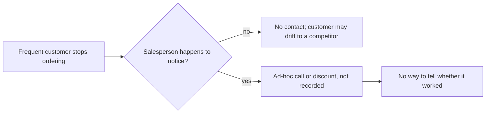
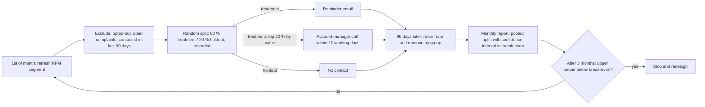

# Win-back programme: requirements

Version 1.0 · Scope: option C from the business case (reminder email to the at-risk segment, personal
call to its top 20 % by value, no blanket discount) with a random holdout.

## 1. Goal and success measure

| | |
|---|---|
| Business goal | Bring formerly frequent customers back to ordering, without paying for orders that would have come anyway |
| Primary KPI | 90-day return rate, treatment vs holdout (percentage points) |
| Secondary KPIs | 90-day revenue per targeted customer; unsubscribe rate; calls completed |
| Decision threshold | Break-even uplift for option C: +1.3 points at 40 % margin (+1.1 to +2.2 across 25–50 %) |
| Out of scope | Discounts (separate randomised test only), new-customer acquisition, changes to the shop |

## 2. Stakeholders (RACI)

| Activity | Sales lead | CRM / marketing | Account managers | Data analyst | Finance |
|---|---|---|---|---|---|
| Approve programme and stop rule | A | C | C | C | C |
| Refresh segment and holdout monthly | I | C | I | R/A | I |
| Send reminder emails | I | R/A | I | C | – |
| Call top-value customers | A | I | R | C | – |
| Measure uplift and report | I | I | I | R/A | C |
| Confirm margin and cost assumptions | C | – | – | C | R/A |

R responsible · A accountable · C consulted · I informed

## 3. Process

As-is: nothing is triggered when a frequent customer stops ordering; a salesperson may notice by chance.



To-be: a monthly cycle with a holdout, so every contact is measured.



## 4. Functional requirements (MoSCoW)

| ID | Requirement | Priority |
|---|---|---|
| FR1 | Refresh the at-risk segment on the 1st of each month with the documented RFM rule (12 months of history, tie-consistent scores) | Must |
| FR2 | Exclude customers who opted out of marketing, have an open complaint, or were contacted in the previous 90 days | Must |
| FR3 | Assign each eligible customer at random to treatment (80 %) or holdout (20 %) with a recorded seed; never re-assign within the 90-day window | Must |
| FR4 | Send the reminder email to the treatment group only | Must |
| FR5 | Produce a call list of the top 20 % of the treatment group by prior 12-month spend, with last order date and top products | Must |
| FR6 | Record every contact (email sent, call made, outcome) against the customer and the cycle | Must |
| FR7 | Report monthly: return rate and 90-day revenue by group, pooled uplift with a 95 % confidence interval, against the break-even uplift | Must |
| FR8 | Flag the stop rule automatically when it is met | Should |
| FR9 | Let finance update margin and cost assumptions in one place; recompute break-even | Should |
| FR10 | Split results by country and by value tier | Could |
| FR11 | Discount codes | Won't (this release; separate test) |

## 5. Non-functional requirements

| ID | Requirement |
|---|---|
| NFR1 | Marketing contact only for customers whose consent or legitimate-interest basis is recorded; every email has a working unsubscribe. Processing follows UK GDPR / PECR (or EU GDPR for EU customers). |
| NFR2 | The assignment and the report are reproducible: same inputs and seed give the same groups and the same numbers. |
| NFR3 | Customer-level data stays in the CRM and warehouse; the report shows aggregates only. |
| NFR4 | The monthly refresh and report run in under 30 minutes of analyst time. |

## 6. User stories and acceptance criteria

**US1 – Segment refresh.** As a data analyst, I want the at-risk segment rebuilt automatically each month, so
that the list is current and the rule is applied the same way every time.

```gherkin
Given sales up to the last day of the previous month
When the refresh runs on the 1st
Then every customer with recency score <= 2 and frequency score >= 3 is in the segment
And customers with equal recency or order counts receive equal scores
And the run stores the segment size and the rule version
```

**US2 – Holdout.** As the sales lead, I want a random group that gets no contact, so that I can see what the
programme adds over customers coming back on their own.

```gherkin
Given an eligible segment of N customers
When the assignment runs with seed S
Then 20 % (rounded) are in holdout and the rest in treatment
And running it again with the same N and S gives the same groups
And no holdout customer appears in the email or call lists
```

**US3 – Call list.** As an account manager, I want a short list of high-value lapsed customers with context,
so that I can make a useful call rather than a cold one.

```gherkin
Given the treatment group for this cycle
When the call list is produced
Then it contains the top 20 % by 12-month spend, sorted by spend
And each row shows last order date, months as a customer and top three products
And the list excludes anyone contacted in the last 90 days
```

**US4 – Measurement.** As the sales lead, I want a monthly result against break-even, so that I know whether
to continue.

```gherkin
Given at least one completed 90-day window
When the monthly report runs
Then it shows return rate and revenue per customer for treatment and holdout
And the pooled uplift with a 95 % confidence interval
And the break-even uplift from the current margin and cost assumptions
And it marks "stop" when, after three cycles, the interval's upper bound is below break-even
```

**US5 – Opt-out.** As a customer, I want to stop these emails with one click, so that I am not contacted
again.

```gherkin
Given a customer clicks unsubscribe
When the next segment refresh runs
Then the customer is excluded from treatment and from the call list
```

## 7. Data requirements

| Data | Source | Used for |
|---|---|---|
| Invoice lines with customer id, date, quantity, price | Order system / warehouse (`sales` table after cleaning) | Segment, outcome |
| Marketing consent and opt-outs | CRM | FR2, NFR1 |
| Open complaints | Customer service system | FR2 |
| Contact log | CRM | FR6, exclusions |
| Margin and cost assumptions | Finance | Break-even |

13.4 % of revenue has no customer id (guest or offline orders); those customers cannot be targeted or
measured, which the report must state.

## 8. Traceability

| Goal / KPI | Requirements | Stories |
|---|---|---|
| Return rate uplift vs holdout | FR1, FR3, FR7 | US1, US2, US4 |
| Spend only where it pays | FR5, FR8, FR9 | US3, US4 |
| Lawful, respectful contact | FR2, NFR1, NFR3 | US5 |

## 9. Risks

| Risk | Effect | Mitigation |
|---|---|---|
| Uplift below break-even | Small loss (worst case about GBP 2,220 for a cycle at current assumptions) | Stop rule after three cycles |
| Holdout too small to measure in one cycle | No clear answer early | Pool across cycles; decision rests on economics, not one test |
| Peak season inflates return rates | Over-states the programme | Holdout is in the same season by design |
| Margin assumption wrong | Break-even shifts | Finance owns the assumption; sensitivity table in the workbook |
